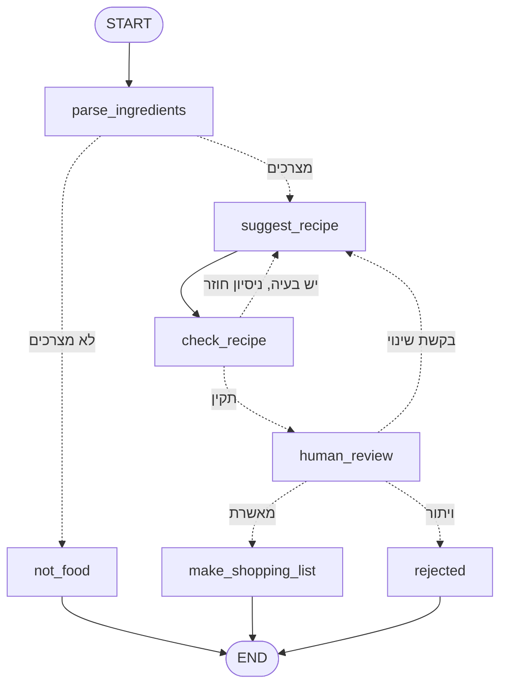

# 🍳 Fridge Chef: מה יש במקרר?

סוכן AI שמקבל רשימה של מה שיש לכם במקרר, מציע מתכון **כשר** ופשוט, בודק את עצמו, מחכה לאישור שלכם ומכין רשימת קניות.

הפרויקט נבנה כעבודת סיום לקורס **LangGraph** ו‑**LangSmith**, עם Gemini כמודל השפה ו‑Streamlit כממשק.

## מה יש בפרויקט

| נושא מהקורס | איפה זה בקוד |
|---|---|
| `StateGraph` ו‑State משותף | `fridge_chef/state.py`, `fridge_chef/graph.py` |
| Nodes | `fridge_chef/nodes.py` |
| ניתוב מותנה (conditional edges) | `route_after_parse`, `route_after_check`, `route_after_human` |
| לולאה: הסוכן מתקן את עצמו | `check_recipe` → `suggest_recipe` (עד 3 ניסיונות) |
| Structured output (Pydantic) | `fridge_chef/schemas.py` |
| Human in the loop עם `interrupt()` | `human_review` |
| Checkpointer (`InMemorySaver`) | `build_graph()` |
| LangSmith Tracing | אוטומטי דרך `.env` |
| LangSmith Evaluation | `evaluation/run_eval.py` |
| בדיקות אוטומטיות | `tests/test_graph.py` (עם LLM מדומה, בלי מפתחות) |

## הגרף



1. **parse_ingredients**: ה‑LLM קורא את הטקסט החופשי ומחזיר רשימת מצרכים נקייה. אם זה לא נראה כמו רשימת מצרכים (למשל "מה מזג האוויר?"), הגרף מסתיים ב‑`not_food`.
2. **suggest_recipe**: ה‑LLM מציע מתכון במבנה קבוע: שם, סוג (בשרי, חלבי או פרווה), מצרכים ושלבי הכנה.
3. **check_recipe**: בדיקה בקוד פייתון רגיל, בלי LLM:
   - אין ערבוב של בשר וחלב.
   - המנה תואמת להעדפה שהמשתמש ביקש.
   - חסרים לכל היותר 3 מצרכים (לא כולל מלח, שמן וכדומה).
   - יש לפחות 2 שלבי הכנה.

   אם יש בעיה, הגרף חוזר ל‑`suggest_recipe` עם רשימת הבעיות, עד 3 ניסיונות.
4. **human_review**: הגרף **עוצר** עם `interrupt()`. ה‑checkpointer שומר את המצב, וממשק ה‑Streamlit מציג את המתכון. המשתמש מאשר, מבקש שינוי (ואז חוזרים לשלב 2) או מוותר.
5. **make_shopping_list**: רשימת קניות של המצרכים החסרים.

## התקנה והרצה

```bash
git clone <כתובת הריפו>
cd <שם התיקייה>
python -m venv .venv
# Windows:
.venv\Scripts\activate
# Mac / Linux:
source .venv/bin/activate

pip install -r requirements.txt
```

מעתיקים את `.env.example` לקובץ חדש בשם `.env` וממלאים בו את המפתחות:

- `GOOGLE_API_KEY`: מפתח Gemini מ‑[Google AI Studio](https://aistudio.google.com).
- `LANGSMITH_API_KEY`: מפתח מ‑[LangSmith](https://smith.langchain.com) (Settings ← API Keys).

הקובץ `.env` מופיע ב‑`.gitignore` ולא עולה לגיטהב.

### הפעלת האפליקציה

```bash
streamlit run app.py
```

### הרצת הבדיקות (לא צריך מפתחות)

```bash
pytest
```

### הרצת ה‑Evaluation ב‑LangSmith

```bash
python -m evaluation.run_eval
```

הסקריפט יוצר ב‑LangSmith dataset בשם `fridge-chef-examples` עם 11 דוגמאות, כולל דוגמאות "מלכודת" כמו בשר עם גבינה, ושתי דוגמאות שאינן רשימת מצרכים. אחר כך הוא מריץ עליהן את הסוכן ומדרג כל ריצה לפי:

| Evaluator | מה הוא בודק |
|---|---|
| `detects_food_correctly` | האם הסוכן זיהה נכון אם זו רשימת מצרכים |
| `kosher` | אין בשר וחלב יחד |
| `matches_preference` | המנה תואמת לבקשה (בשרי, חלבי או פרווה) |
| `few_missing_ingredients` | לכל היותר 3 מצרכים לקנות |
| `passed_check_first_try` | המתכון הראשון כבר עבר את הבדיקה |
| `no_problems` | המתכון הסופי עובר את כל הבדיקות |

## LangSmith: מה רואים

### Tracing
כל ריצה של האפליקציה נרשמת בפרויקט `fridge-chef` ב‑LangSmith. אפשר לראות כל node, את הקריאות ל‑Gemini, זמנים, טוקנים, ואת הרגעים שבהם הסוכן חזר לתקן את עצמו.


### Evaluation


## מבנה הפרויקט

```
├── app.py                 # ממשק Streamlit
├── fridge_chef/
│   ├── graph.py           # בניית הגרף והניתוב
│   ├── nodes.py           # הצמתים
│   ├── state.py           # ה-State
│   ├── schemas.py         # מבני הפלט (Pydantic)
│   └── llm.py             # יצירת מודל Gemini
├── evaluation/
│   ├── dataset.py         # דוגמאות הבדיקה
│   └── run_eval.py        # הרצת ה-Evaluation ב-LangSmith
├── tests/test_graph.py    # בדיקות עם LLM מדומה
├── requirements.txt
└── .env.example
```
